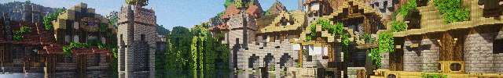

# Ainulindalë: Lost Tales

An add-on for **The Lord of the Rings Mod: Legacy** on Minecraft 1.7.10.

Lost Tales is built for roleplay servers. It adds characters you create and play as,
fellowships, quests, a chat system with channels, map and HUD tools, an accessory slot,
a third-person camera, and some Middle-earth content of its own.

Still in development. Features and behaviour can change between releases.

## Requirements

- Minecraft 1.7.10
- Forge 10.13.4.1614
- LOTR Mod: Legacy, Update v36.15 (the coremod is tied to this version)
- GeckoLib 3.0.40 or newer

Both LOTR and GeckoLib are hard dependencies. The game will not start without them.

## Building

- **Java 8.** Gradle 4.6 and ForgeGradle 1.2 do not run on a newer JDK, so point `JAVA_HOME`
  at a JDK 8 before calling the wrapper.
- **Two jars in `libs/`**, which the build reads from there:
  - `LOTRMod v36.15-deobf.jar`, a deobfuscated build of LOTR Legacy Update v36.15;
  - `geckolib-unofficial-1.7.10-1.0.4-deobf.jar`, a deobfuscated build of GeckoLib.

  They belong to their authors. `libs/` is ignored by git, and neither jar is ever committed
  or redistributed with this mod.
- **Gradle tasks**, through the wrapper (`gradlew` or `gradlew.bat`):
  - `setupDecompWorkspace` once, to prepare the Forge dev environment;
  - `build` for the mod's jar in `build/libs/`, `assemble` for the jar alone, `test` for the
    unit tests;
  - `runClient` and `runServer` to play from the sources, in `eclipse/` (the server needs its
    EULA accepted there). `-PrunArgs="--username <name>"` picks the account.
- **The coremod in a dev run.** A classes directory has no jar manifest, so the coremod loads
  only with `-Dfml.coreMods.load=com.ninuna.losttales.core.LostTalesCorePlugin`. The Gradle run
  tasks add it; a run configuration of your own needs it as a JVM argument.

## Notes

The mod ships a coremod, so a few classes are patched at load time rather than through
Forge events. That ties it fairly closely to the LOTR version it was built against.

Current version: 0.1.3
